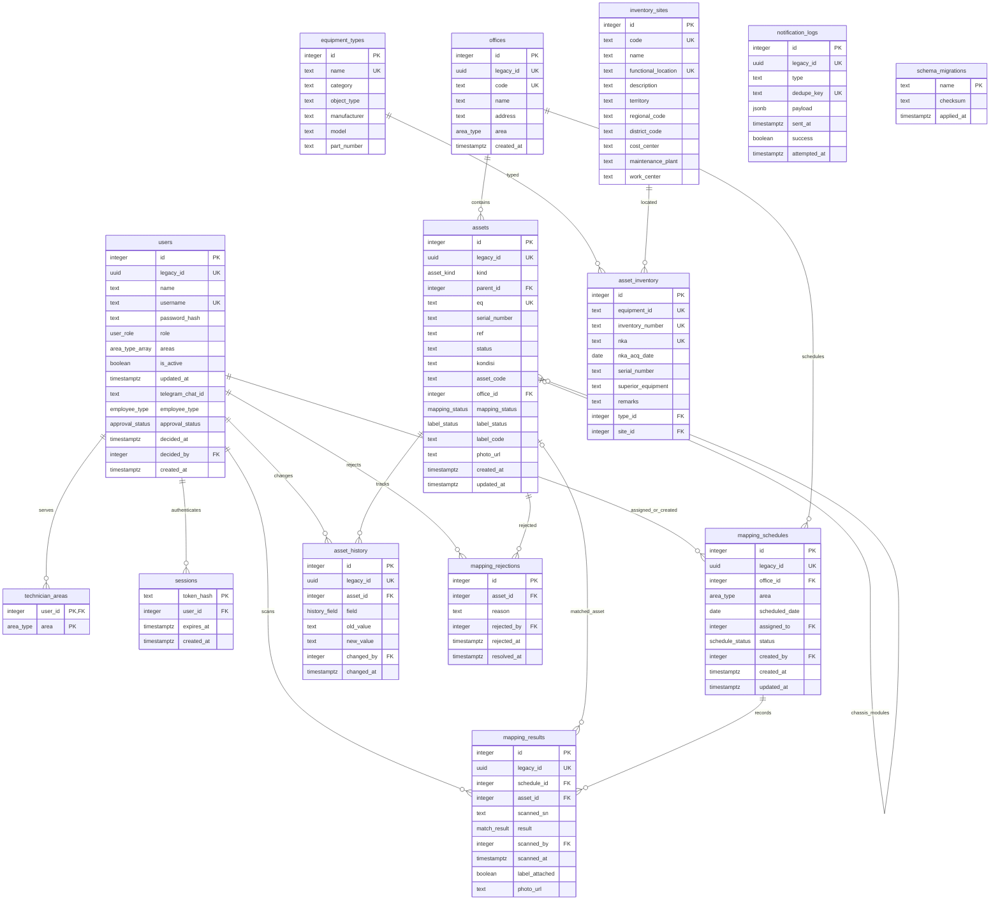

# ERD Backend Caps2Tone

Skema dieksekusi melalui migrasi 001 sampai 008. Struktur bisnis mengikuti `queryDB.md`: ID integer, enum PostgreSQL, dan kolom `kondisi`. UUID lama disimpan dalam kolom `legacy_id` pada tabel entitas. `offices.area` ditambahkan untuk memvalidasi kecocokan area jadwal dengan kantor. `sessions` dan `schema_migrations` mendukung sesi yang dapat dicabut serta migrasi terkontrol.

`assets.serial_number` diindeks dan tidak unik. EQ dan kode kantor unik. Partial unique index `(office_id, scheduled_date)` berlaku untuk jadwal `terjadwal`/`berjalan`. FK mengikuti kebijakan migrasi: parent aset dan penugasan memakai SET NULL, riwayat aset memakai CASCADE, sesi memakai CASCADE, dan referensi lain mempertahankan pembatasan penghapusan. Aset tidak memiliki endpoint penghapusan fisik.

Trigger memvalidasi induk chassis sekantor dan penugasan teknisi sesuai area. Trigger audit mewajibkan `app.user_id` untuk perubahan ref/status/kondisi, lalu mencatat nilai lama/baru di transaksi yang sama. Driver mengatur actor lewat `set_config(..., true)` sehingga tidak bocor ke transaksi lain pada pool.

## Migrasi 004 sampai 008

| Migrasi | Isi |
|---|---|
| `004_asset_inventory` | Master inventaris dari CSV: `equipment_types`, `inventory_sites`, `asset_inventory`. Berdiri sendiri; `Equipment ID` di sini berbeda dari `assets.eq` dan `inventory_sites` berbeda dari `offices`. `superior_equipment` hanya teks karena induknya tidak ada di dataset. |
| `005_employee_registration` | `users.employee_type` (karyawan/magang), `approval_status` (menunggu/aktif/ditolak/nonaktif), `decided_at`, `decided_by`. Trigger `users_sync_approval` menjaga `is_active` tetap sinkron dengan `approval_status`. |
| `006_mapping_rejections` | Penolakan hasil mapping oleh admin. Satu baris per penolakan; penolakan aktif adalah baris dengan `resolved_at IS NULL` (paling banyak satu per aset) dan diselesaikan saat teknisi memetakan ulang. |
| `007_photo_urls` | `photo_url` di `assets` (foto terbaru) dan `mapping_results` (bukti per scan). Hanya URL Cloudinary proyek ini yang diterima API. |
| `008_inventory_link` | `offices.site_id` dan `assets.inventory_id` (nullable, unik) menautkan kantor ke `inventory_sites` dan aset kerja ke `asset_inventory`. Master adalah sumber kebenaran; `npm run inventory:sync` mengisi kantor (satu per site) dan aset kerja (satu per baris master, `eq` = Equipment ID). |
